# 미티 (MEETY)

실시간 음성으로 회의에 참여하는 능동형 AI 팀원 에이전트

회의를 같이 듣다가, 회의가 막히는 순간을 알아채고 먼저 나서서 풀어 주는 AI 팀원입니다.
2026 CNU 창의SW/AI축전 창의작품경진대회 출품작, 팀 돼지옥수수

[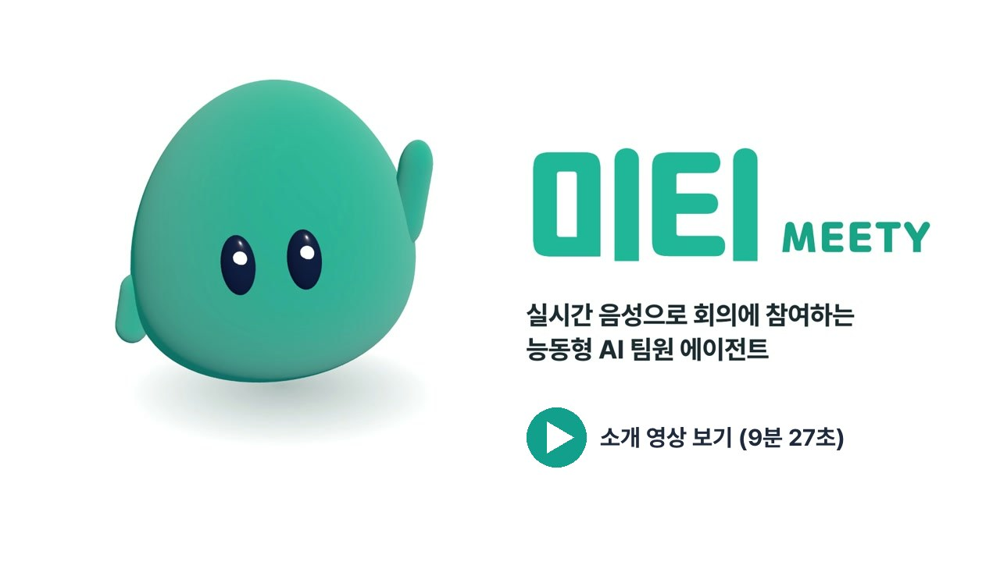](https://youtu.be/8-cOoeTNm4A)

- 소개 영상: https://youtu.be/8-cOoeTNm4A

**목차**: [왜 만들었나](#왜-만들었나) | [미티가 하는 일](#미티가-하는-일) | [화면](#화면) | [핵심 아키텍처](#핵심-아키텍처) | [설계 방식](#설계-방식) | [구현 방법](#구현-방법) | [STT와 TTS 파이프라인](#stt와-tts-파이프라인) | [지연 최적화](#지연-최적화) | [보안](#보안) | [조사와 시행착오](#조사와-시행착오) | [평가와 한계](#평가와-한계) | [실행](#실행)

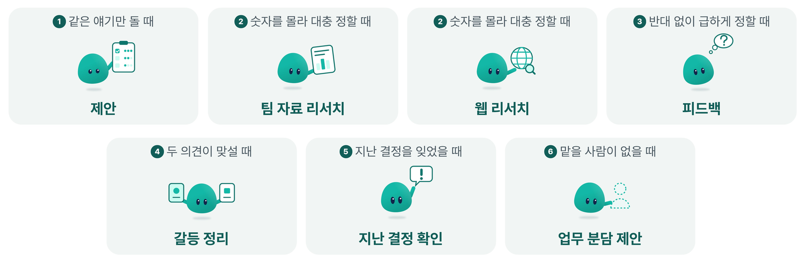

## 왜 만들었나

회의는 종류마다 목적이 다르지만, 의견을 내고, 근거를 확인하고, 서로 피드백하고, 결론을 맞추고, 일을 나누는 과정은 대부분의 회의에 있습니다. 그리고 이 과정에서 회의는 자주 막힙니다.

1. 같은 얘기만 돌고 새 아이디어가 안 나옴
2. 필요한 숫자를 몰라 대충 정함
3. 반대 의견 없이 급하게 정함
4. 두 의견이 맞서 결론이 안 남
5. 지난번에 정한 걸 잊고 처음부터 다시 얘기함
6. 할 일은 정했는데 맡을 사람이 없음

모두 참여자라 이런 순간에 한발 물러나 정리해 줄 사람이 없습니다. 회의 준비는 각자 AI로 잘 하지만, 회의 중에는 채팅창에 따로 묻고 답을 읽어 다시 전해야 하고, 그 AI는 우리 팀이 지난번 정한 것도 방금 오간 말도 모릅니다.

## 미티가 하는 일

| 막히는 순간 | 미티 |
| --- | --- |
| 같은 얘기만 돌 때 | **제안** 기록과 자료를 근거로 아이디어를 냄 |
| 숫자를 몰라 대충 정할 때 | **팀 자료 리서치** 팀 자료에서 찾아 출처와 함께 보여 줌 / **웹 리서치** 팀 자료에 없는 바깥 정보는 웹에서 찾음 |
| 반대 없이 급하게 정할 때 | **피드백** 걸리는 점을 물음 |
| 두 의견이 맞설 때 | **갈등 정리** 두 안을 기준별로 나눠 보여 줌 |
| 지난 결정을 잊었을 때 | **지난 결정 확인** 날짜와 근거를 들어 짚음 |
| 맡을 사람이 없을 때 | **업무 분담 제안** 누가 맡을지 정하자고 함 |

- 1:1 회의에서는 부르지 않아도 대화하듯 같이 회의하고, 여러 명 회의에서는 참여도에 맞춰 먼저 말하고 "미티야" 하면 바로 대답합니다.
- 말하기 전에 왜 말하는지와 근거 기록을 화면에 먼저 띄웁니다.
- 사람이 말을 시작하면 바로 멈추고, 못 한 말은 손든 카드로 남깁니다.
- 오래 말이 없는 팀원에게는 그 사람 화면으로만 의견을 묻습니다(**조용한 팀원**).
- 얼마나 나설지는 참여도 다이얼(0~10)로 팀이 정합니다. "조용히", "더 끼어들어" 같은 말이나 화면 버튼으로 바로 바꿉니다.

## 화면

**회의 중 미티 화면** 말하는 이유와 근거 기록, 받아쓰기를 함께 보여 줍니다.

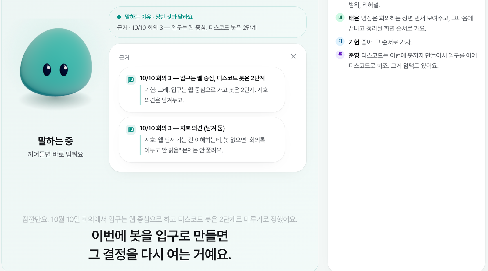

**회의 준비** 지난 회의에서 남은 일과 읽고 들어갈 팀 자료를 고릅니다. 안건은 적지 않아도 됩니다.

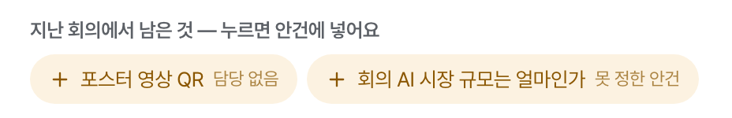
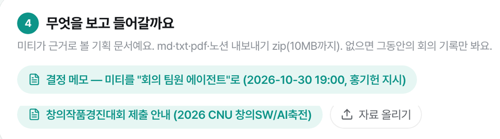

**회의 뒤 정리** 바뀐 결정은 이전 결정, 근거 발언과 함께 보여 주고, 팀원이 확인한 것만 Notion과 Discord로 보냅니다.

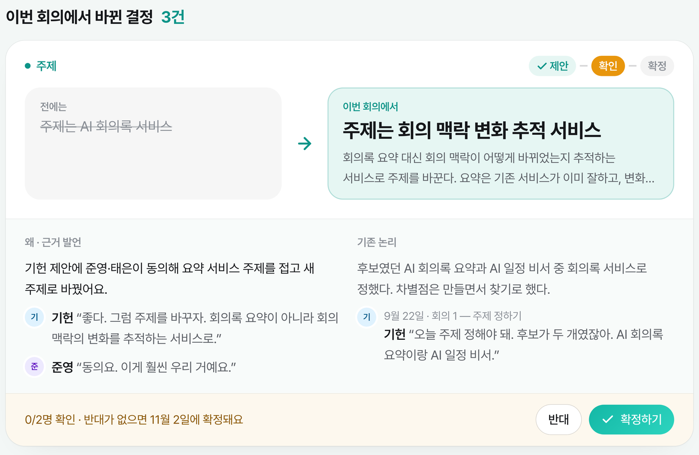

## 핵심 아키텍처

브라우저가 가운데에서 음성 서버와 두뇌를 잇습니다. 음성 서버는 말을 글로, 글을 말로 바꾸고, 두뇌는 언제 무엇을 말할지 정합니다. 둘은 서로 직접 부르지 않고, 주고받는 모양은 계약 파일 [`src/lib/live/contract.ts`](src/lib/live/contract.ts) 하나로 고정했습니다.

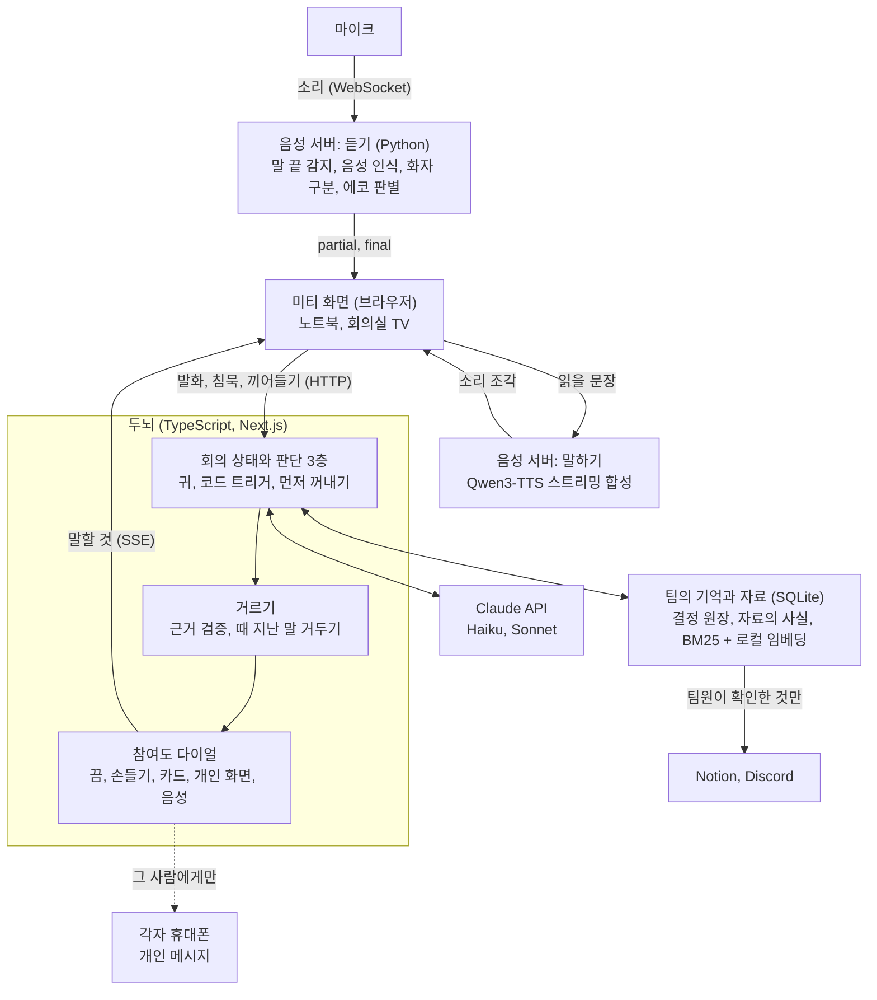

| 구성 | 하는 일 | 어디서 도나 | 코드 |
| --- | --- | --- | --- |
| 음성 서버 | 말 끝 감지, 음성 인식, 화자 구분, 에코 판별, 음성 합성 | 노트북 (음성 인식만 기본 Soniox) | [`voice/`](voice/) |
| 두뇌 | 회의 상태 유지, 판단 3층, 검증, 출력 방식 결정 | 노트북, 판단은 Claude API | [`src/lib/live/`](src/lib/live/) |
| 미티 화면 | 3D 마스코트, 이유 카드, 자막, 손든 항목, 개인 메시지 | 브라우저 | [`src/components/live/`](src/components/live/) |
| 팀 자료 | 읽기, 조각 나누기, 사실 뽑기, 검색 | 노트북, 사실 뽑기는 Claude API | [`src/lib/ingest/`](src/lib/ingest/) |
| 팀의 기억 | 결정 원장, 회의 뒤 정리 파이프라인 | 노트북, 정리는 Claude API | [`src/lib/head.ts`](src/lib/head.ts), [`src/lib/agent.ts`](src/lib/agent.ts) |
| 연동 | Notion 읽기(MCP)와 쓰기(REST), Discord 웹훅 | 노트북 | [`src/lib/integrations/`](src/lib/integrations/) |

**한 번의 끼어들기**: 지난 결정과 다른 말이 나왔을 때의 흐름입니다.

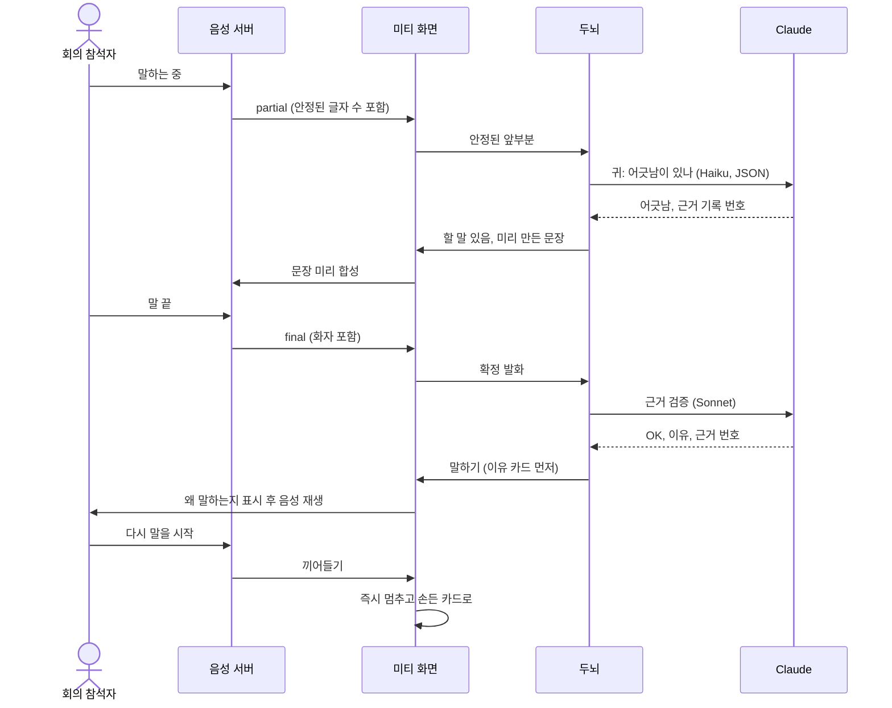

말하는 도중 미리 판단하는 부분은 참여도 5 이상에서 켜집니다. 검증은 말 준비와 함께 돌고, 아니라고 나오면 말하기 전에 거둡니다. 질문, 결정을 다시 열자는 논의, 안 끝난 말, 부정하는 말처럼 헷갈리기 쉬운 경우에는 검증이 끝나야 말합니다.

## 설계 방식

**1. 언제 말할지는 코드가 정합니다.** 모델에 회의를 통째로 맡기지 않습니다. 코드가 언제 무엇을 볼지 정하고, 모델은 정해진 형식의 좁은 질문에만 답합니다.

**2. 근거가 없으면 말하지 않습니다.** 근거는 기록 번호로만 대고, 애매하면 "없음"입니다. 지난 결정을 짚는 말은 다른 지시로 한 번 더 확인하고, 그사이 대화가 더 있었으면 그 대화까지 보고 다시 확인합니다.

**3. 기본은 가만히입니다.** 먼저 꺼낼지 고를 때 기본 선택지가 "가만히"이고, 침묵 길이, 쉬는 시간, 미티 말 비중을 코드가 확인합니다.

**4. 얼마나 나설지는 팀이 정합니다.** 다이얼 하나가 역할별 출력 방식, 판단 간격, 쉬는 시간을 함께 정합니다. 낮으면 말 대신 화면에 손만 듭니다.

**5. 틀려도 위험하지 않게 만듭니다.** 미티는 기록을 읽기만 합니다. 할 수 있는 일을 이벤트 목록으로 고정해, 속더라도 지우거나 고칠 수단이 없습니다.

**6. 팀의 결정과 문서 내용을 나눕니다.** 결정은 "팀이 정한 것", 자료의 사실은 "문서에 적혀 있는 것"입니다. 문서는 낡을 수 있어서, 문서와 어긋나면 단정하지 않고 질문으로 묻습니다.

### 두뇌의 흐름

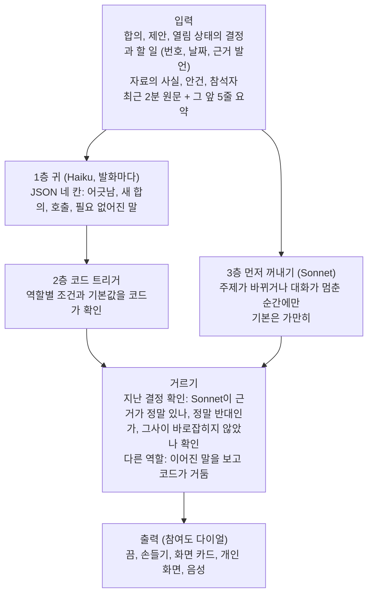

| 역할 | 언제 나서나 (기본값) | 말로 나서는 참여도 |
| --- | --- | --- |
| 지난 결정 확인 | 1층이 확정된 것과 반대되는 말을 찾고 검증 통과 | 3 이상 |
| 업무 분담 제안 | 담당이 필요한 합의에 이름이 없고 한 마디가 지나도 안 나옴 | 5 이상 |
| 피드백 | 3마디 안에 반론 없이 정한 합의가 걸리는 기록과 25% 넘게 겹침 | 6 이상 |
| 갈등 정리 | 최근 8마디에 반대 말 3번 넘게, 두 사람 이상, 같은 논점. 격한 말이면 참음 | 7 이상 |
| 팀 자료 리서치 | "뭐였지?" 뒤 1.5초 동안 아무도 답하지 않음 | 8 이상 (그 아래는 카드) |
| 제안 | 아이디어를 찾는 말 뒤 5초 더 조용함 | 8 이상 |
| 조용한 팀원 | 3명 이상 회의에서 다른 사람 말이 24마디 이어지는 동안 말이 없음 | 2 이상, 그 사람 화면에만 |

전체 조건과 먼저 꺼내기 공식은 [에이전트 두뇌 설계](docs/brain-design.md)에 있습니다.

## 구현 방법

**회의 중 두뇌** ([`meeting.ts`](src/lib/live/meeting.ts), [`roles.ts`](src/lib/live/roles.ts), [`prompts.ts`](src/lib/live/prompts.ts))
- 회의 상태는 서버 메모리에 두고, 화면으로는 SSE로 이벤트를 흘립니다.
- 모델 출력은 Zod 스키마로 모양을 고정합니다. 자유 문장이 곧바로 행동으로 이어지지 않습니다.
- 회의를 시작할 때 확정 항목마다 "누가 반대로 말하면 짚을 한 문장"을 미리 써 둡니다. 그래서 모델을 기다리지 않고 바로 말할 수 있습니다.
- 역할과 모델의 짝은 표 한 곳([`models.ts`](src/lib/live/models.ts))에서 바꿉니다. 판단은 빠른 Haiku, 말할 문장과 검증은 Sonnet입니다.
- 첫 토큰이 늦으면 같은 요청을 하나 더 보내고 먼저 끝난 쪽을 씁니다(헤징, Haiku 1.3초, Sonnet 1.8초). 고정된 지시문은 프롬프트 캐시로 비용을 줄입니다.

**팀의 기억** ([`head.ts`](src/lib/head.ts), [`agent.ts`](src/lib/agent.ts))
- 현재 결정은 저장된 값이 아니라 변경 기록(커밋)을 차례로 재생한 결과입니다. 바뀐 결정은 지우지 않고 이력으로 남고, 모든 변경은 근거 발언으로 거슬러 올라갑니다.
- 회의가 끝나면 받아쓴 글 전체가 정리 파이프라인을 지납니다: 주제 나누기(Haiku) → 결정과 할 일 추출(Opus) → 검수(Sonnet, 버리기만 함) → 코드 검사 후 저장 → 브리핑.
- 합의된 결정을 바꾸는 변경은 모델 판단과 상관없이 코드가 사람 확인으로 돌립니다.

**팀 자료 검색** ([`src/lib/ingest/`](src/lib/ingest/))
- md, txt, pdf, zip(Notion 내보내기)과 Notion 페이지를 읽습니다. 제목 구조를 따라 나누고 조각은 2,500자를 넘지 않습니다.
- Haiku가 조각에서 한 문장짜리 사실을 뽑습니다. 파일 해시, 모델, 지시문 버전을 캐시 열쇠로 써서 바뀐 것만 다시 뽑습니다.
- 글자 2-gram BM25와 로컬 임베딩(multilingual-e5-small) 결과를 RRF로 합칩니다. 임베딩이 없거나 늦으면 BM25만으로 계속합니다.
- 회의 중 카드는 뽑아 둔 사실을 그대로 보여 줘서 지어낼 틈이 없고, 출처(문서, 위치, 인용)가 늘 붙습니다.

**연동** ([`src/lib/integrations/`](src/lib/integrations/))
- 읽기는 MCP, 쓰기는 직접 API입니다. 쓰기는 중복 방지와 수정까지 직접 다뤄야 해서 나눴습니다.
- 내보내기는 유니크 키로 여러 번 보내도 하나만 생기고, 결정이 바뀌면 글을 지우지 않고 고칩니다.

**버티기**
- Soniox가 끊기거나 늦으면 그 마디는 whisper가 받아 적습니다. 음성 합성은 Qwen3-TTS가 죽으면 Supertonic으로 넘어갑니다.
- 모델 호출에 오류를 넣어도 회의가 죽지 않고 기록은 계속됩니다(`tests/live/faults.test.ts`).

**시험**: 자동 시험 600개 이상(단위, 보안, 시나리오 재생)을 `npm test`로 돌립니다. 역할 판단은 대본 시나리오([`tests/live/scenarios/`](tests/live/scenarios/))로 채점합니다.

자세히: [시스템 구조](docs/architecture.md)

## STT와 TTS 파이프라인

**듣기**

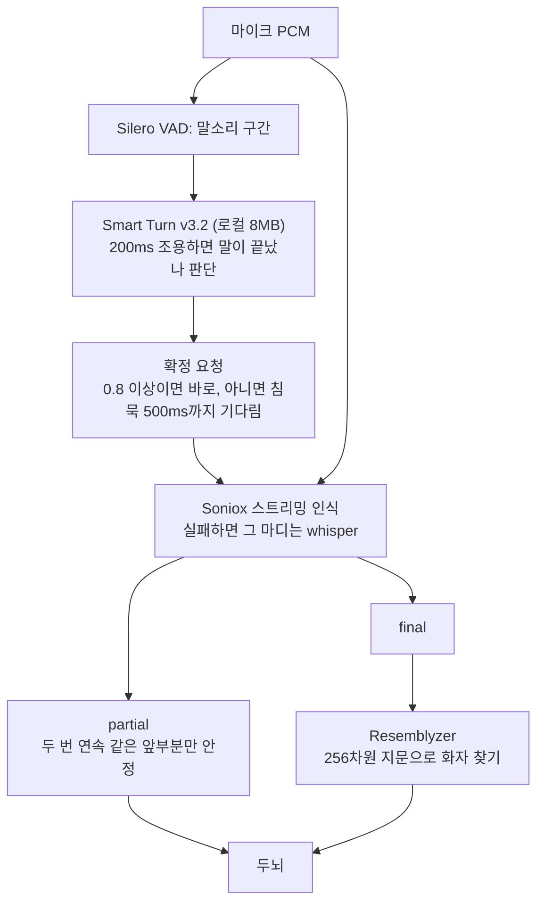

**말하기와 끼어들기**

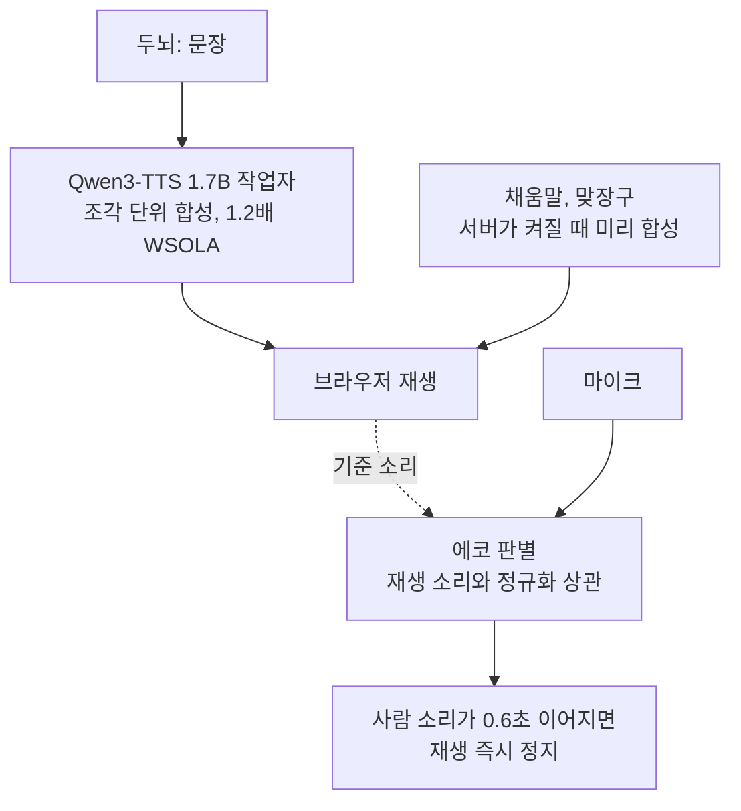

**음성 인식(STT)**
- 클라우드 1종과 로컬 3종을 같은 조건에서 쟀습니다. 기본은 Soniox입니다. 정확도가 가장 높고, 중간 결과를 고쳐 쓰는 비율이 whisper의 56.9%에 비해 1.3%로 낮아 말하는 도중 판단에 쓰기 좋았습니다.
- 키를 비우면 음성이 노트북 밖으로 나가지 않는 mlx-whisper(마디 단위)로 돕니다. 로컬 스트리밍 엔진은 GPU를 내내 잡아 음성 합성을 0.16초에서 0.91초로 늦춰서 쓰지 않았습니다.
- 말 끝은 음성 서버가 정합니다. Soniox 자체 말 끝은 더 늦고(700ms, Smart Turn 344ms) 문장 중간에서 더 끊겼습니다.
- 두 번 연속 같은 앞부분만 믿는 규칙으로 틀린 글자를 18.4%에서 0%로 줄여, 말이 끝나기 전에 판단을 시작할 수 있게 했습니다.

**화자 구분**
- 회의 전에 각자 5초쯤 말해 256차원 목소리 지문을 노트북에 저장하고, 확정 문장마다 코사인 유사도로 가장 가까운 사람을 붙입니다. 0.75 미만이면 모름으로 둡니다.

**에코와 끼어들기**
- 회의실에서는 스피커 소리가 다시 마이크로 들어옵니다. 지금 읽는 소리와의 정규화 상관으로 에코인지 사람인지 가립니다(시험에서 에코만 0.99, 사람 0.21~0.37). 방 울림이 큰 짧은 소리는 문턱을 따로 둡니다.
- "네", "음", 기침에 멈추지 않도록, 사람 소리가 0.6초 이어져야 끼어들기로 봅니다.

**음성 합성(TTS)**
- 오픈소스 한국어 모델 5종을 비교해 Apache-2.0 라이선스의 Qwen3-TTS 1.7B를 골랐습니다. 첫 소리, 메모리, 잘못 읽는 정도, 라이선스를 함께 봤습니다.
- 별도 프로세스의 작업자가 문장을 조각으로 합성해 보내고, 화면은 첫 조각부터 재생합니다.
- 들쭉날쭉한 말투는 온도, top_k, 씨앗을 고정해 줄이고, 합성한 소리를 다시 받아 적어 잘못 읽는 문장을 찾았습니다.
- 말 빠르기 1.2배는 ffmpeg 파이프가 입력을 붙잡아 첫 소리가 늦어져서, 조각 단위로 처리하는 WSOLA를 직접 구현했습니다([`tts_stretch.py`](voice/tts_stretch.py)). 어떻게 조각을 나눠 넣어도 한 번에 넣은 결과와 같습니다.
- 채움말과 맞장구는 서버가 켜질 때 미리 합성합니다. 종류마다 3~4벌을 두어 같은 소리만 되풀이하지 않습니다.

측정표 전체: [조사와 측정 기록](docs/research.md)

## 지연 최적화

사람이 말을 마친 순간부터 미티의 첫 음성까지 단계마다 기록하고 줄였습니다. 음성 인식, 판단, 음성 합성을 차례로 기다리지 않고 동시에 흐르도록 구성했습니다.

| 단계 | 바꾼 것 | 결과 |
| --- | --- | --- |
| 발화 종료 감지 | 침묵을 기다리지 않고, 말이 끝났는지 소리로 판단하는 Smart Turn v3.2 적용 | 말 끝 → 음성 인식 확정 908ms → 552ms |
| 스트리밍 음성 합성 | Qwen3-TTS로 바꾸고 문장을 조각으로 합성하며 바로 재생 | 첫 음성까지 725ms → 112ms |
| 2단계 응답 생성 | Haiku가 첫 문장, Sonnet이 나머지를 이어서 만듦 | 말 끝 → 첫 응답 문장 2.22초 → 1.41초 |
| 발화 중 선행 판단 | 상대가 말하는 동안 안정된 앞부분으로 판단 시작 | 음성 인식 확정 → 응답 시작 1.27초 → 0.43초 |
| 끼어들기와 채움말 | 끼어들면 재생을 즉시 멈추고, "음…" 같은 채움말은 미리 합성 | 음성 정지 0ms, 말 끝 → 채움말 0.3초 이내 |
| 운영 비용 | 판단을 정해진 때에만 부르고 입력 길이를 일정하게 유지 | 회의 1시간 판단 비용 약 0.5달러 (실제 녹음 71분에서 0.61달러) |

측정 조건
- 앞의 두 줄은 지금 설정(Soniox, Qwen3-TTS)의 값입니다. 552ms는 실제 1:1 녹음 8발화의 중앙값이고, 첫 음성 112ms는 음성 합성 작업자 기준입니다(서버를 거치면 약 40ms 더해짐).
- 2단계 응답과 선행 판단, 채움말은 whisper로 만든 재생 이벤트로 쟀습니다. Soniox 기준으로는 아직 다시 재지 않았습니다.
- 비용에는 Soniox 음성 인식(시간당 약 0.12달러)과 회의 뒤 정리가 들어 있지 않습니다.

## 보안

"하지 마"라고 부탁하는 대신, 위험한 일은 애초에 할 수 없게 만듭니다. 공격 6종 141건(코드 시험 78건, 실제 모델 63건)을 직접 만들어 시험했고 뚫린 경우는 0건입니다. 시험 중에 찾은 구멍 9개는 고치고 시험으로 남겼습니다.

| 위협 | 설계 | 시험 |
| --- | --- | --- |
| 말과 자료 속 명령 주입 | 발언과 자료는 데이터로만 다룸. 미티가 내보낼 수 있는 이벤트와 판단 값이 코드로 고정됨 | 42건 중 따른 경우 0 |
| 남의 목소리로 설정 변경 | 등록된 목소리만 인정. 낮추기는 말로 바로, 올리기는 화면 확인만. 인식이 뚫려도 최악은 조용해지는 것 | 20건 중 성공 0 |
| 기록 위변조 | 미티에게 지우거나 고치는 기능이 없음. 합의된 결정 변경은 코드가 사람 확인으로 돌림 | 27건 모두 차단 |
| 다른 팀 자료 노출 | 검색과 판단은 그 팀 자료만, 서버 요청마다 멤버 확인 | 12건 모두 차단 |
| 사람 평가, 사람인 척 | 사람 평가 유도에 응하지 않고, AI임을 숨기지 않음 | 40건 모두 통과 |
| 연동 토큰, MCP | AES-256-GCM 암호화, 공식 주소만 허용, 읽기 도구만 호출, 인가 발행자 대조 | 연동 시험 35건 통과 |
| 되돌려 쓰기 | 회의 중에는 쓰지 않음. 확인된 결정만, 유니크 키로 한 번만 | 연동 시험에 포함 |

**데이터가 어디로 가나**: Soniox 키가 있으면 회의 음성은 Soniox로, 받아쓴 글과 자료 조각은 Claude API로 갑니다. 키를 비우면 음성은 노트북 안에서 처리됩니다. 목소리 지문과 음성 합성, 임베딩은 늘 노트북 안입니다. 음성 저장은 기본으로 꺼져 있습니다.

**설계만 한 것**: 변경 기록 해시 체인, 하려다 안 한 일까지 남기는 감사 기록, 회의 글도 밖으로 나가지 않는 완전 로컬 모드, 팀별 암호화 열쇠는 아직 코드에 없습니다.

자세히: [보안 설계](docs/security.md)

## 조사와 시행착오

**읽은 연구와 반영한 것**

| 연구 | 반영한 것 |
| --- | --- |
| [Levinson & Torreira 2015](https://www.frontiersin.org/journals/psychology/articles/10.3389/fpsyg.2015.00731/full): 사람은 0~200ms 안에 말을 받음 | 먼저 꺼내는 말은 아무도 받지 않은 침묵에서만 |
| [Speak for Me](https://arxiv.org/abs/2609.03923) (EMNLP 2026): 프롬프트만 쓴 모델은 말할 기회의 51.4%에서 침묵 | "말할지"를 프롬프트에 맡기지 않고 상태와 결정 층을 따로 둠 |
| [Jarvis](https://arxiv.org/abs/2610.07506) (2026): 사람이 스스로 고칠 틈을 주고, 손들기를 선호 | 말하기 직전 검증, 쿨다운, 손들기 |
| [Are We On Track?](https://arxiv.org/abs/2504.01082) (CHI 2025): 늦게 뜬 개입은 쓸모없음 | 말하는 도중 미리 판단, 때 지난 말은 버림 |
| [Controlling AI Agent Participation](https://arxiv.org/abs/2501.17258) (IUI 2025): 불만은 길고 잦은 말 | 참여도 다이얼, 짧은 말투 |
| [How Should the Agent Communicate to the Group?](https://dl.acm.org/doi/10.1145/3555112) (CSCW 2022): 조용한 사람에게는 개인 메시지 | 조용한 팀원은 그 사람 화면에만 |
| [Bringing Everyone to the Table](https://arxiv.org/abs/2508.08242) (CSCW 2026): AI 진행자로 참여는 늘었지만 정답률은 차이 없음 | "결정이 좋아진다"고 주장하지 않음 |

**직접 해 보고 바꾼 것**
- **회의 뒤 정리에서 회의 중 팀원으로**: 처음에는 끝난 회의에서 결정을 뽑아 쌓는 도구였습니다. 돌려 보니 뽑은 결정을 사람이 확인할 일만 늘었고, 지난 결정과 달라진 점을 짚는 기능이 가장 필요한 때는 회의가 끝난 뒤가 아니라 그 말이 나온 순간이었습니다. 결정 이력 구조만 살려 방향을 바꿨습니다.
- **먼저 말하기를 다시 설계**: [Inner Thoughts](https://arxiv.org/abs/2501.00383)처럼 후보마다 점수를 매겨 거르게 했더니, 실제 회의 녹음 71분에서 한 번도 먼저 말하지 않았습니다. 후보를 모아 두고 주제가 바뀌거나 대화가 멈춘 순간에 고르는 지금 방식으로 바꿨습니다.
- **잘못 끼어든 것 잡기**: 같은 71분 녹음에서 설명하는 말을 결정과 어긋난다고 잘못 짚은 적이 있습니다. 안 끝난 말과 부정하는 말은 확인을 거치게 고치고, 어긋남이 아닌 경우를 프롬프트에 하나씩 정의했습니다.
- **빠르기만으로 고르지 않음**: 첫 소리가 가장 빠른 모델로 바꿨지만 목소리가 "느리고 축 처진다"는 평가가 나왔습니다. 말투와 재생 속도를 바꾼 후보를 다시 만들어 듣고 골랐습니다.
- **프레임워크로 옮기지 않음**: Pipecat, LiveKit, 실시간 음성 모델을 조사했지만 모두 한 명 대화를 전제로 해서 네 명 회의 화자 구분은 어차피 직접 해야 했습니다. 음성 서버는 직접 구성하고 Smart Turn만 가져왔습니다.
- **측정값 의심하기**: 처음 잰 Soniox 오류율 24.4%는 엔진이 아니라 우리 연결 코드 버그였습니다. 고치고 다시 재서 비교했습니다.

자세히: [조사와 측정 기록](docs/research.md)

## 평가와 한계

| 항목 | 결과 |
| --- | --- |
| 역할 판단 | 지난 결정 확인 대본 15개를 참여도 2, 5, 8에서 채점, 57항목 중 55, 56, 57개. 잘못 끼어든 경우 0. 다른 역할 대본 12개 통과 |
| 시연 반복 | 결정 충돌 장면을 실제 음성으로 5번 연속, 모두 지적이 끝까지 재생 |
| 화자 구분 | 실제 회의 녹화 349발화 중 331발화(94.8%), 다른 사람으로 붙인 경우 0 |
| 자료 검색 | 질문 120개 중 108개에서 상위 3개 안에 정답 |
| 화면 | 크롬에서 초당 60프레임 |

**아직 못 한 것**
- 미티가 실제 회의에 주는 효과는 아직 측정하지 않았습니다. 스타트업 팀과 기업 부서의 소규모 회의에서 시험하고 심층 인터뷰로 확인할 계획입니다.
- 네 명이 한 회의실에서 쓰는 환경의 음성 인식은 합성 녹음으로만 쟀습니다. 2m 떨어지고 울림이 있으면 글자 오류율이 5.3%에서 16.3%로 오릅니다.
- Google 캘린더, GitHub, Slack 연동, 미티의 기억을 다른 AI 도구에서 읽는 MCP 서버, 회의에서 나온 할 일을 미리 조사해 오는 기능은 설계까지 했습니다.

## 어떻게 동작하나 (문서)

- [시스템 구조와 실시간 음성 파이프라인](docs/architecture.md)
- [에이전트 두뇌 설계](docs/brain-design.md): 입력, 판단 3층, 역할별로 나서는 조건과 기본값
- [보안 설계](docs/security.md): 위협, 대응, 시험, 아직 설계만 한 것
- [조사와 측정 기록](docs/research.md): 논문, 프레임워크, STT, TTS, 말 끝 판단 비교표

## 실행

macOS(Apple Silicon)에서 개발하고 시험했습니다.

1. 준비물: Node.js 20 이상, Python 3.12
2. 설치
   ```bash
   npm install
   python3.12 -m venv voice/.venv
   voice/.venv/bin/pip install -r voice/requirements.txt -r voice/requirements-tts.txt
   ```
3. 키: 저장소 맨 위에 `.env.local`을 만들고 키를 넣습니다. `.env.example`을 참고하세요.
   - `ANTHROPIC_API_KEY` (필수, 판단과 대답)
   - `SONIOX_API_KEY` (선택, 실시간 음성 인식. 없으면 노트북 안에서 도는 whisper를 씀)
4. 예시 팀 데이터 만들기
   ```bash
   npm run seed
   ```
5. 회의 열기(음성 서버와 앱을 함께 켭니다)
   ```bash
   npm run meeting
   ```
   출력된 주소(기본 `http://localhost:3100/live/new`)에서 회의를 시작합니다.

시험은 `npm test`로 돌립니다. 실제 모델을 부르는 보안 시험은 `LIVE_LLM=1 npm run eval:security`입니다.

## 폴더

| 폴더 | 내용 |
| --- | --- |
| `src/lib/live/` | 회의 중 두뇌: 판단, 트리거, 출력 방식, 프롬프트 |
| `src/lib/ingest/` | 팀 자료 읽기와 검색(키워드 + 임베딩) |
| `src/lib/integrations/` | Notion, Discord 연동과 토큰 암호화 |
| `src/components/` | 회의 중 미티 화면, 회의 준비, 회의 뒤 정리 화면 |
| `voice/` | 음성 서버: 발화 종료 감지, 음성 인식, 화자 구분, 음성 합성 |
| `scripts/` | 회의 열기, 예시 데이터, 재생 평가 도구 |
| `tests/` | 단위 시험, 보안 시험, 시나리오 재생 시험 |

## 팀 돼지옥수수

충남대학교 컴퓨터융합학부, 지도교수 김재정

- 팀장 홍기헌
- 팀원 엄태은, 황준영, 김지호
